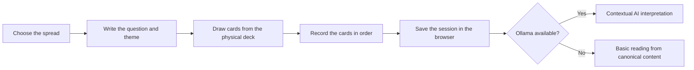

# Limiar — Waite Tarot

An informative, interactive portal (in Brazilian Portuguese) to study all 78 Rider-Waite cards and interpret spreads drawn with a physical deck.

Limiar never shuffles or draws cards. You draw with your own deck, record the sequence on the site and get a reading based on the project's canonical content. When Ollama is available, the app also writes a contextual AI interpretation; if the service fails, the basic reading is still there.

> Readings are symbolic and reflective. They do not replace medical, psychological, legal or financial advice.

[🇧🇷 Leia em português](#-português)

## Features

- Searchable library with the 22 Major and 56 Minor Arcana.
- Meanings by context: general, career, love and future trends.
- Card pages with symbolism, keywords and a reference to the source manual.
- Dynamic Card of the Day, rotating through all 78 cards without repeats in a cycle.
- Eight spread types, from a single card to the Astrological Mandala.
- Guided recording of cards drawn from a physical deck: **Enter** registers the first search result, the step indicator works as navigation, and you can go back to any completed step.
- **Resumable spreads:** question, theme, recorded cards and step are kept for 24 hours per spread type, so reloading or closing the browser doesn't lose progress.
- Optional contextual interpretation with Ollama, choosing between Gemma 3 and Qwen 3.5 models.
- Full local model management from the portal: install with progress, select for readings, remove.
- Automatic basic reading when local AI isn't available.
- History of up to 50 readings stored in the browser, with **undo** for single or bulk deletions.
- Responsive UI, animations, back-to-top button and respect for reduced-motion preferences.
- Unit, component, content and end-to-end tests.

## Tech stack

| Area | Technology |
| --- | --- |
| App | Next.js 16, React 19 and TypeScript |
| Styles | Tailwind CSS 4 and global CSS |
| Animation | Motion |
| Validation | Zod |
| Local AI | Ollama (Gemma 3 and Qwen 3.5) |
| Tests | Vitest, Testing Library and Playwright |
| Content | Python, pypdf and Pillow |
| Package manager | pnpm |

## How a reading works



The API validates the question, spread type, card count and each position before calling Ollama. The model's answer also goes through a strict schema and cannot introduce cards that weren't drawn.

## Prerequisites

- To run the app: [Node.js](https://nodejs.org/) 20.9+ and [pnpm](https://pnpm.io/).
- For AI interpretation: [Ollama](https://ollama.com/) running, with at least one compatible model.
- To regenerate content from the PDF: Python 3.11+ with `pypdf` and `Pillow`.

## Easy install on Windows

Double-click `ABRIR_LIMIAR_TARO.bat` (**Limiar Tarô — Início Fácil**). It creates a desktop shortcut with its own icon, checks Node.js, installs dependencies, prepares `.env.local` and offers an optional menu to install, list or remove Ollama models. At the end it keeps the terminal open and shows how to open [http://localhost:3000](http://localhost:3000).

Windows can't embed icons in `.bat` files, so the repo ships the native shortcut `Limiar Tarô - Início Fácil.lnk`, pointing to the `.bat` and using `assets/limiar-taro.ico`. `.lnk` files store the folder path they were created in: after cloning or moving the project, run the `.bat` once and it updates both shortcuts. To open only the model manager: `ABRIR_LIMIAR_TARO.bat --ollama-only`.

## Manual install

```powershell
pnpm install
Copy-Item .env.example .env.local
pnpm dev
```

Open [http://localhost:3000](http://localhost:3000). Content, images and the basic reading are already in the repo, so Ollama and Python aren't needed just to browse.

## Local interpretation with Ollama

The current maximum is **12 cards**. The free spread accepts 4 to 12 cards, the Astrological Mandala uses 12, and the API rejects anything above that.

### Compatible models

| Model | Approx. download | Profile | Recommended use |
| --- | ---: | --- | --- |
| `gemma3:4b` | 3.3 GB | Light | Smaller spreads on modest machines; less consistent near 12 cards. |
| `qwen3.5:4b` | 3.4 GB | Light | Modern, economical option for short and medium readings. |
| `qwen3.5:9b` | 6.6 GB | Balanced | Best overall balance for up to 12 cards. |
| `gemma3:12b` | 8.1 GB | Balanced | Project default, consistent in Portuguese and structured output. |
| `qwen3.5:27b` | 17 GB | Powerful | More capacity to relate many positions; needs strong hardware. |
| `gemma3:27b` | 17 GB | Powerful | Highest Gemma quality for dense readings. |

Sizes are those listed in the official Ollama library and may change. Limiar uses a 16K context window, enough for the canonical context of 12 cards, and validates the returned JSON. Smaller models save memory but are more likely to return an incomplete answer on long spreads.

```powershell
ollama pull qwen3.5:9b
ollama pull gemma3:12b
ollama serve
pnpm dev
```

By default the Next.js server calls `http://127.0.0.1:11434`. Generation can take a few minutes depending on hardware and card count; the default timeout is six minutes.

Open **Modelos** in the portal menu (`/modelos`) to install models with progress, switch the active model or delete installed ones without a terminal. Deletion only unlocks after typing the exact model id. The spread's first step and the result page also let you switch models; the choice is saved in the browser.

## Environment variables

Create `.env.local` from `.env.example`:

| Variable | Required | Default / purpose |
| --- | --- | --- |
| `NEXT_PUBLIC_SITE_URL` | Recommended | Canonical URL for metadata, sitemap and sharing. |
| `OLLAMA_BASE_URL` | No | Ollama address. Default `http://127.0.0.1:11434`. |
| `OLLAMA_MODEL` | No | Initial model when no preference is saved. Default `gemma3:12b`. |
| `OLLAMA_TIMEOUT_MS` | No | Max interpretation time in ms. Default `360000`. |

Never commit `.env.local` or credentials.

## Commands

| Command | Description |
| --- | --- |
| `pnpm dev` | Development server. |
| `pnpm build` / `pnpm start` | Production build and run. |
| `pnpm lint` | ESLint. |
| `pnpm test` / `pnpm test:watch` | Vitest once / watch mode. |
| `pnpm test:e2e` | Playwright on desktop and mobile. |
| `pnpm content:validate` | Validates cards, spreads, sources and image files. |
| `pnpm content:prepare -- "path\\manual.pdf"` | Regenerates data and images from the manual. |

## Main routes

| Route | Content |
| --- | --- |
| `/` | Home and project intro. |
| `/cartas` and `/cartas/[slug]` | Full library with search and filters; card details. |
| `/guia` | Introductory guide to the Waite Tarot. |
| `/tiragens` and `/tiragens/[slug]` | Spread catalog; guided flow to record a physical spread. |
| `/tiragens/resultado/[id]` | Basic reading and contextual interpretation. |
| `/historico` | Readings stored in this browser. |
| `/modelos` | Local Ollama model management. |
| `/api/interpretations` | Internal `POST` endpoint that validates and calls Ollama. |

## Spread types

| Spread | Cards | Purpose |
| --- | ---: | --- |
| Single card | 1 | Core message for a simple question. |
| Two cards | 2 | Main message plus complement or counterpoint. |
| Jumping cards | 4–12 | Free sequence recorded in the order it appeared. |
| Timeline | 3 | Past, present and trend. |
| Advice | 3 | Situation, challenge and advice. |
| Polarities | 3 | Favorable forces, tensions and outcome. |
| Celtic Cross | 10 | Deep reading of causes, environment and trends. |
| Astrological Mandala | 12 | Broad view of twelve areas of life. |

## Project structure

```text
LimiarTarot/
├── public/cards/                 # Images and thumbnails of the 78 cards
├── scripts/                      # PDF extraction and content validation
├── src/
│   ├── app/                      # Next.js routes, layouts, metadata and API
│   ├── components/               # UI, animation, library and spreads
│   ├── data/                     # Cards, guide, spreads and licenses (JSON)
│   ├── hooks/                    # Reusable hooks
│   ├── lib/                      # Domain rules, persistence, drafts and Ollama
│   └── types/                    # TypeScript contracts
├── tests/e2e/                    # Playwright scenarios
└── .env.example
```

## Content pipeline

The JSON files and optimized images are versioned; the original PDF isn't read at runtime.

```powershell
python -m venv .venv
.\.venv\Scripts\python.exe -m pip install pypdf Pillow
pnpm content:prepare -- "C:\path\Waite Tarot Manual.pdf"
pnpm content:validate
```

The extractor preserves the source text, generates a normalized Brazilian Portuguese version, records source pages, flags editorial gaps as `needs-review`, produces WebP images and thumbnails and updates source, attribution and checksum metadata. If Wikimedia Commons rate-limits downloads, pass a local mirror with `--mirror-dir`.

## Quality and tests

```powershell
pnpm content:validate
pnpm test
pnpm lint
pnpm build
pnpm test:e2e
```

Playwright starts or reuses the server at `http://127.0.0.1:3000` and runs `desktop` and `mobile` projects. On first run: `pnpm exec playwright install chromium`.

## Persistence and privacy

Readings are stored in `localStorage` (the 50 most recent), on the device and browser used, and can be deleted individually or from the history screen. In-progress spreads are kept as drafts for 24 hours. When you request an interpretation, the question, theme, spread and cards go to the internal `/api/interpretations` endpoint, which builds a canonical context and forwards it to the Ollama set in `OLLAMA_BASE_URL`.

## Build and deploy

The frontend deploys to any Next.js-compatible platform such as Vercel. Set `NEXT_PUBLIC_SITE_URL` to the public domain (previews also use `VERCEL_URL`).

In production, `127.0.0.1` points to the app's own server, not the visitor's computer. To offer AI interpretations remotely, set `OLLAMA_BASE_URL` to an instance reachable by the server and protect it. Without it, the portal still offers the basic reading.

## Troubleshooting

- **AI interpretation doesn't work:** check `ollama list`, pull a compatible model, confirm `OLLAMA_BASE_URL` and that nothing blocks port `11434`.
- **Model runs out of memory:** switch to `qwen3.5:4b` or `gemma3:4b`, close heavy apps and try again.
- **Playwright can't find a browser:** `pnpm exec playwright install chromium`.
- **PowerShell blocks venv activation:** call `.\.venv\Scripts\python.exe` directly instead of activating.

## Sources and editorial note

Local images use the public-domain RWS1909 deck. `src/data/image-licenses.json` records source, attribution and checksum for each image. The manual doesn't separate career and love meanings for the **8 of Swords**; those fields stay flagged for review and the UI doesn't invent missing content.

---

## 🇧🇷 Português

# Limiar — Tarô de Waite

Portal informativo e interativo em português brasileiro para estudar as 78 cartas do Rider-Waite e interpretar tiragens feitas com um baralho físico.

O Limiar não embaralha nem sorteia cartas. A pessoa faz a tiragem com o próprio baralho, registra no site a sequência obtida e recebe uma leitura baseada no conteúdo canônico do projeto. Quando o Ollama está disponível, a aplicação também produz uma interpretação contextual por IA; se o serviço falhar, a leitura básica continua acessível.

> As interpretações têm finalidade simbólica e reflexiva. Elas não substituem orientação médica, psicológica, jurídica ou financeira.

### Recursos

- Biblioteca pesquisável com os 22 Arcanos Maiores e 56 Arcanos Menores.
- Significados por contexto: geral, carreira, amor e tendências futuras.
- Páginas individuais com simbolismo, palavras-chave e referência ao manual.
- Carta do Dia dinâmica, girando pelas 78 cartas sem repetir no ciclo.
- Oito modalidades de tiragem, de uma carta à Mandala Astrológica.
- Registro guiado das cartas: **Enter** registra o primeiro resultado da busca, o indicador de etapas funciona como navegação e dá para voltar a qualquer etapa concluída.
- **Tiragem retomável:** pergunta, tema, cartas e etapa ficam salvos por 24 horas por modalidade; recarregar ou fechar o navegador não perde o progresso.
- Interpretação contextual opcional com Ollama, escolhendo entre Gemma 3 e Qwen 3.5.
- Gerenciamento completo dos modelos locais pelo portal: instalação com progresso, seleção e remoção.
- Leitura básica automática quando a IA local não está disponível.
- Histórico de até 50 tiragens no navegador, com **desfazer** nas exclusões individuais ou totais.
- Interface responsiva, animações, botão de voltar ao topo e respeito ao movimento reduzido.
- Testes unitários, de componentes, de conteúdo e ponta a ponta.

### Tecnologias

Next.js 16, React 19, TypeScript, Tailwind CSS 4, Motion, Zod, Ollama (Gemma 3 e Qwen 3.5), Vitest, Testing Library, Playwright, Python (pypdf e Pillow) e pnpm.

### Como a leitura funciona

Escolher a tiragem → escrever a pergunta e o tema → tirar as cartas no baralho físico → registrar as cartas na ordem → salvar a sessão no navegador → interpretação por IA (se o Ollama estiver disponível) ou leitura básica pelo conteúdo canônico. A API valida pergunta, modalidade, quantidade e posição das cartas antes de consultar o Ollama, e a resposta do modelo passa por um schema estrito que não deixa introduzir cartas ausentes.

### Pré-requisitos

- Para rodar: Node.js 20.9+ e pnpm.
- Para a IA: Ollama em execução com pelo menos um modelo compatível.
- Para regenerar o conteúdo do PDF: Python 3.11+ com `pypdf` e `Pillow`.

### Instalação fácil no Windows

Dê dois cliques em `ABRIR_LIMIAR_TARO.bat` (**Limiar Tarô — Início Fácil**). Ele cria um atalho com ícone na Área de Trabalho, verifica o Node.js, instala as dependências, prepara o `.env.local` e oferece um menu opcional para instalar, listar ou remover modelos do Ollama. No fim, mostra como acessar [http://localhost:3000](http://localhost:3000).

Como o Windows não incorpora ícones em `.bat`, o repositório inclui o atalho `Limiar Tarô - Início Fácil.lnk`, que usa `assets/limiar-taro.ico`. Atalhos `.lnk` guardam o caminho da pasta: depois de clonar ou mover o projeto, rode o `.bat` uma vez para atualizar os dois atalhos. Para abrir só o gerenciador de modelos: `ABRIR_LIMIAR_TARO.bat --ollama-only`.

### Instalação manual

```powershell
pnpm install
Copy-Item .env.example .env.local
pnpm dev
```

O conteúdo, as imagens e a leitura básica já estão no repositório; Ollama e Python não são necessários só para navegar.

### Interpretação local com Ollama

O máximo atual é **12 cartas**: a tiragem livre aceita de 4 a 12, a Mandala usa 12 e a API rejeita acima disso. Os modelos compatíveis, tamanhos e perfis estão na tabela da versão em inglês acima; `gemma3:12b` é o padrão e `qwen3.5:9b` é o melhor equilíbrio geral. O Limiar usa janela de 16K e valida o JSON retornado.

```powershell
ollama pull qwen3.5:9b
ollama pull gemma3:12b
ollama serve
pnpm dev
```

Por padrão, o Next.js consulta `http://127.0.0.1:11434`, com limite de seis minutos. Em **Modelos** (`/modelos`) dá para instalar com progresso, trocar o modelo ativo ou excluir modelos sem terminal; a exclusão só é liberada depois de digitar o identificador exato. A primeira etapa da tiragem e a página de resultado também permitem trocar o modelo, e a escolha fica salva no navegador.

### Variáveis de ambiente

Crie `.env.local` a partir de `.env.example`: `NEXT_PUBLIC_SITE_URL` (recomendada, URL canônica), `OLLAMA_BASE_URL` (padrão `http://127.0.0.1:11434`), `OLLAMA_MODEL` (padrão `gemma3:12b`) e `OLLAMA_TIMEOUT_MS` (padrão `360000`). Nunca versione `.env.local`.

### Comandos

`pnpm dev`, `pnpm build` / `pnpm start`, `pnpm lint`, `pnpm test` / `pnpm test:watch`, `pnpm test:e2e` (desktop e mobile), `pnpm content:validate` e `pnpm content:prepare -- "caminho\\manual.pdf"`.

### Rotas e modalidades

As rotas (`/`, `/cartas`, `/guia`, `/tiragens`, `/tiragens/resultado/[id]`, `/historico`, `/modelos` e `/api/interpretations`) e as oito modalidades (Carta única, Duas cartas, Cartas que saltaram, Linha do tempo, Aconselhamento, Polaridades, Cruz Celta e Mandala Astrológica) estão detalhadas nas tabelas da versão em inglês.

### Pipeline de conteúdo

Os JSONs e as imagens otimizadas já estão versionados; o PDF não é lido durante a execução.

```powershell
python -m venv .venv
.\.venv\Scripts\python.exe -m pip install pypdf Pillow
pnpm content:prepare -- "C:\caminho\Manual do Tarô de Waite.pdf"
pnpm content:validate
```

O extrator preserva o texto original, gera a versão normalizada em português, registra as páginas de origem, marca lacunas como `needs-review`, gera imagens WebP e miniaturas e atualiza origem, atribuição e checksum. Se o Wikimedia Commons limitar os downloads, use `--mirror-dir` com um espelho local.

### Qualidade e testes

Antes de publicar: `pnpm content:validate`, `pnpm test`, `pnpm lint`, `pnpm build` e `pnpm test:e2e`. Na primeira execução do Playwright: `pnpm exec playwright install chromium`.

### Persistência e privacidade

As tiragens ficam no `localStorage` (as 50 mais recentes), no navegador e aparelho usados, e podem ser excluídas pelo histórico. Tiragens em andamento ficam salvas como rascunho por 24 horas. Ao pedir uma interpretação, pergunta, tema, modalidade e cartas vão para o endpoint interno `/api/interpretations`, que monta o contexto canônico e consulta o Ollama configurado.

### Build e implantação

O front-end pode ir para qualquer plataforma compatível com Next.js, como a Vercel, com `NEXT_PUBLIC_SITE_URL` apontando para o domínio público. Em produção, `127.0.0.1` é o próprio servidor, não o computador do visitante: para ter IA num deploy remoto, configure `OLLAMA_BASE_URL` com uma instância acessível e protegida. Sem ela, o portal continua com a leitura básica.

### Solução de problemas

- **A IA não funciona:** confira `ollama list`, baixe um modelo compatível, confira `OLLAMA_BASE_URL` e a porta `11434`.
- **O modelo fica sem memória:** troque para `qwen3.5:4b` ou `gemma3:4b` e feche aplicações pesadas.
- **O Playwright não acha o navegador:** `pnpm exec playwright install chromium`.
- **O PowerShell bloqueou a venv:** use `.\.venv\Scripts\python.exe` direto, sem ativar.

### Fontes e observação editorial

As imagens usam o baralho RWS1909 em domínio público, com origem, atribuição e checksum em `src/data/image-licenses.json`. O manual não separa carreira e amor para o **8 de Espadas**; esses campos ficam marcados para revisão e a interface não inventa conteúdo.
